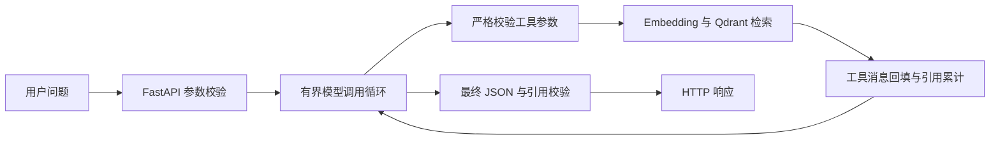

# 交付运维工具知识助手

基于实习业务延伸的个人项目，面向 getinfo、nic_link_check、aidoc_download 的工具使用场景。用户提交自然语言问题，模型通过原生 Function Calling 选择资料范围，Python 校验并执行文档检索，再生成带引用的使用指导。

**技术栈：** Python 3.13、FastAPI、asyncio、Pydantic、Qdrant、火山方舟模型 API。

## 请求处理



- 按工具元数据过滤知识范围，每次最多返回 4 个片段。
- 每轮最多一个工具请求；一次任务最多两次工具执行、三次文本模型请求，第三次禁止继续调用工具。
- 公共业务入口共享 90 秒预算，接口返回 answer、evidence_status、citations。
- 参数、输出结构和引用 ID 分别校验；资料不足时说明缺口，避免把文档示例当作现场配置。

## 快速启动

已验证 Python 3.13。以下以 PowerShell 为例；在仓库根目录执行。

```powershell
python -m venv .venv
.\.venv\Scripts\python.exe -m pip install -r requirements.txt
$env:ARK_API_KEY = "your-ark-api-key"
$env:ARK_MODEL = "your-text-model-or-endpoint-id"
$env:ARK_EMBEDDING_MODEL = "your-multimodal-embedding-endpoint-id"
```

环境变量示例见 [.env.example](.env.example)。程序通过进程环境读取配置，不会自动加载 .env。
Embedding 使用方舟多模态向量接口，当前代码按 2048 维配置；学习环境使用 doubao-embedding-vision-250615，请填写自己的可用接入点。

### 建立本地知识库

仓库包含三类说明的 19 个脱敏片段；向量索引需要在本机生成。

```powershell
.\.venv\Scripts\python.exe .\init_tool_vector_db.py
.\.venv\Scripts\python.exe .\ingest_tool_docs.py
.\.venv\Scripts\python.exe .\ingest_nic_docs.py
.\.venv\Scripts\python.exe .\ingest_aidoc_docs.py
```

入库脚本会调用所配置的 Embedding 服务；日常启动无需重复入库。需要重新切分演示资料时，依次执行 prepare_tool_docs.py、prepare_nic_docs.py、prepare_aidoc_docs.py。
资料来源、公开版本处理方式见 [演示资料说明](data/source_docs/README.md)。

### 启动接口

```powershell
.\.venv\Scripts\python.exe -m uvicorn app.main:app --host 127.0.0.1 --port 18000 --reload
```

打开 http://127.0.0.1:18000/docs。

| 接口 | 请求内容 | 用途 |
| --- | --- | --- |
| POST /agent/ask | question | 模型选择资料范围，可分轮检索并综合回答。 |
| POST /tools/ask | question、tool_name | 固定 RAG 对照入口。 |
| GET /health | 无 | 服务健康检查。 |

Agent 请求示例：

```json
{
  "question": "采集服务器信息和检查 RoCE 线序这两类任务，运行前是否都需要准备主机列表文件 hostfile？请分别依据资料简要说明。"
}
```

响应结构：

```json
{
  "answer": "根据本次检索资料生成的使用指导。",
  "evidence_status": "sufficient",
  "citations": ["getinfo-usage-004", "nic-link-usage-002"]
}
```

资料不足也属于正常回答，返回 200 + insufficient。非法请求返回 422；已知服务/流程错误返回 502；超时返回 504。
命令行入口同样调用业务执行器：

```powershell
.\.venv\Scripts\python.exe .\usage_agent_demo.py
```

## 项目结构

```text
app/
  main.py                 FastAPI 路由与异常转换
  schemas.py              请求与回答模型
  usage_agent.py          有界循环、总预算、累计引用校验
  usage_tools.py          工具声明、参数校验、检索分发
  tool_retrieval.py       Qdrant 工具过滤检索
  embedding_client.py     异步 Embedding 客户端
data/
  source_docs/            可重新切分的脱敏演示说明
  tool_docs/              三类工具共 19 个 JSONL 片段
  fixtures/               synthetic 巡检记录
eval/                     固定 RAG 用例与历史回放
docs/                     设计、验收与优化记录
```

## 已验证内容与优化案例

- 三类资料范围选择均有真实调用记录；跨工具命令行回放完成两次检索与最终引用累计。
- 新 Agent HTTP 入口取得一条真实 200 响应；输入与异常映射另外通过十三项进程内模拟检查。
- 针对 RoCE 参数别名说明遗漏，先核对脚本、修订片段并按原 UUID 更新，再固定查询向量比较 Top-3/4/7；定位必要片段排第四后调整候选数量，回放验证回答改善，现场配置不足时仍保留 insufficient。

详细证据见 [Agent 阶段验收](docs/tool-usage-agent-evidence.md)、[检索记录](docs/tool-usage-retrieval-check.md)、[固定 RAG 回放](docs/tool-usage-eval-2026-10-29.md)。
evaluate_tool_usage.py 当前用于旧 /tools/ask 的 T03/T04 回归，旧六题用例不代表新 Agent 已完成批量评测。

## 当前范围

本项目提供工具使用指导，检索工具不会登录服务器或执行交付脚本。原始业务工具和完整企业文档没有公开；知识片段已移除内部链接、现场标识及内网地址，示例地址使用文档保留网段。
Qdrant 使用本地持久化模式；本地索引、虚拟环境和认证信息未提交。
历史回放经过公开版本脱敏，具体排名和耗时以原学习环境为背景；新模型或新资料需重新评估。尚无生产部署、员工提效或整体准确率指标。
LangGraph、MCP、Skill、长期记忆等属于后续方向。
